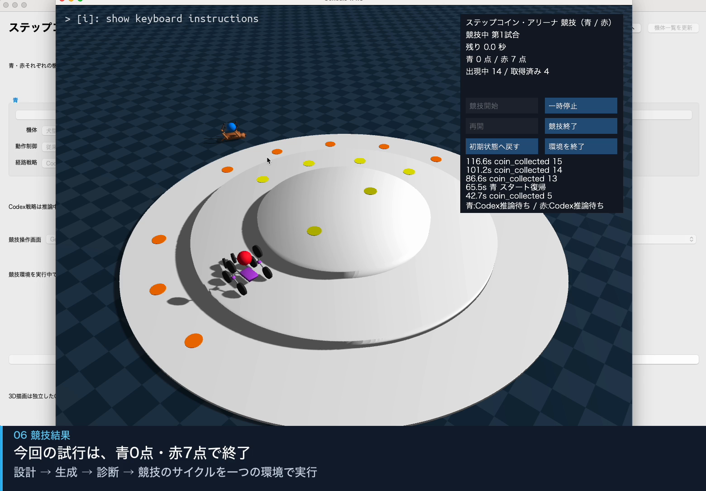
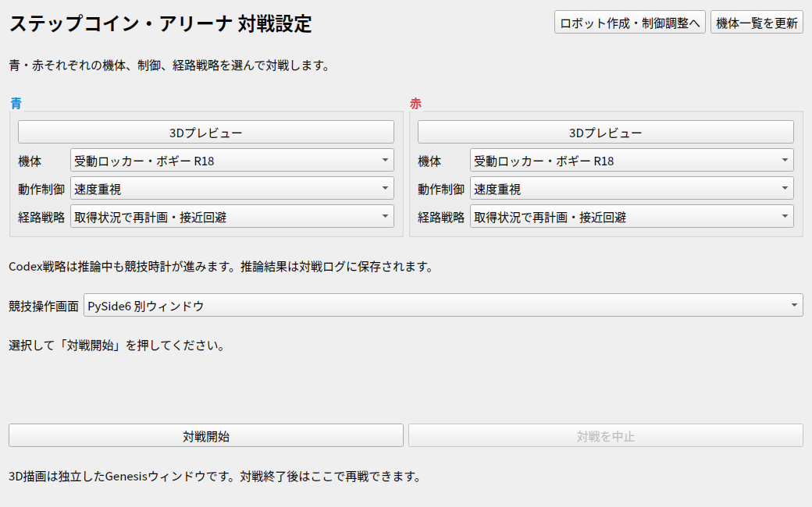
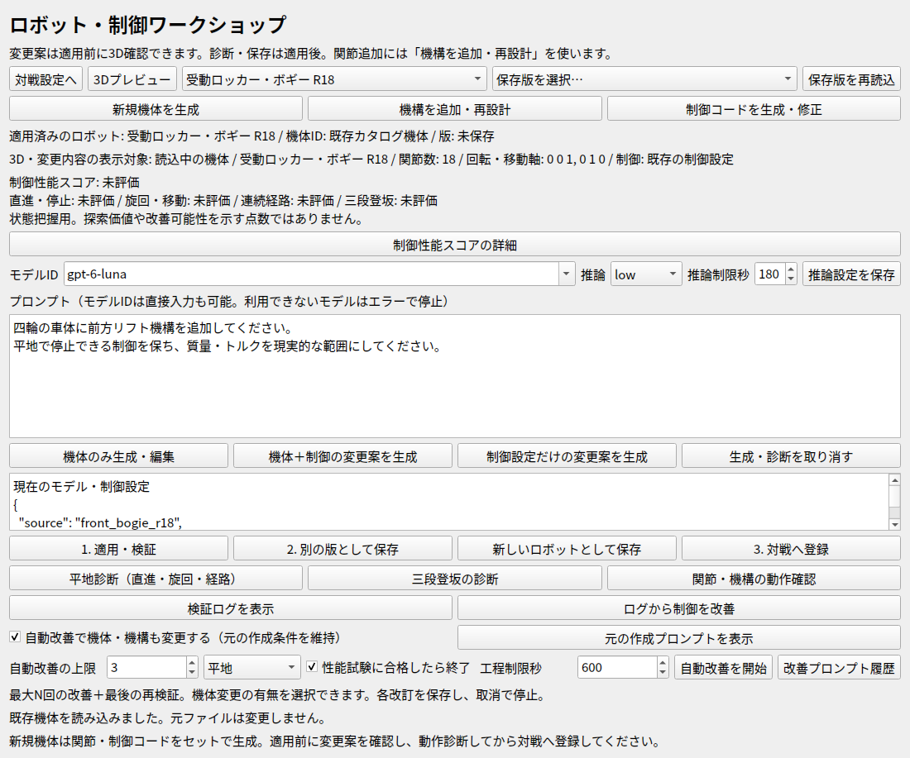

# ステップコイン・アリーナ / Step Coin Arena

**生成AIによるロボット設計・制御の反復改善と、ロボット競技シミュレーション環境。** Physical AI講座の最終課題として作成しました。

3段フィールドで青・赤の2体がコインを取り合います。ロボットや制御、戦略を選択して対戦し、プロンプトによる機体・制御コードの生成、診断ログを使った改善を試せます。標準競技時間は **120シミュレーション秒** です。

[デモ動画（2分51秒・等速）](docs/demo.mp4) · [利用ガイド](docs/usage.md) · [Docker詳細・トラブル対処](docs/docker.md) · [構成と制約](docs/architecture.md) · [検証記録](docs/verification.md)



## まず対戦を試す：Dockerで起動

必要なもの：Git、Docker Engine + Compose v2（Mac/WindowsではDocker Desktop等）、ブラウザ。ホストへのPython・ROS2・Node.js・Codex CLIのインストールは不要です。

初回ビルドはネットワーク接続が必要で、ROS2・PyTorch・Genesisなどをダウンロードします。イメージは数GB規模になるため、ディスク空き容量を確保してください。既定はCPUとソフトウェア描画です。GPUは必須ではありません。

```bash
git clone https://github.com/saotomryo/step-coin-arena.git
cd step-coin-arena
docker compose build
docker compose up -d
```

ブラウザで [http://localhost:6080/vnc.html?autoconnect=true&resize=scale](http://localhost:6080/vnc.html?autoconnect=true&resize=scale) を開きます。ここに表示されるのは、コンテナ内の **Python / PySide6のデスクトップUI** です。アプリ自体をWeb UIへ作り替えたものではありません。

1. 対戦設定画面で、青・赤それぞれの機体・動作制御・経路戦略を選びます。
2. 最初は既定の機体・戦略のまま試してください。既定のルールベース戦略はAI認証不要です。
3. 「対戦開始」を押すとGenesisの画面が開き、初期化後に競技が自動で始まります。物理環境の初期化には時間がかかる場合があります。
4. 競技操作パネルで残り時間・得点・取得イベントを確認できます。手動で待機状態から開始する場合は、パネルの「競技開始」を押します。
5. 一時停止・再開・終了・初期状態へのリセットもパネルで操作できます。



上の画面で青・赤の構成を選びます。競技画面の画像とデモ動画はMacローカル実行の収録、対戦設定とワークショップの画像は今回のDocker内実表示です。

シミュレーション時間と実時間は異なります。CPU・描画負荷によっては、120秒の競技に実時間で2分以上かかります。提出動画はMacのローカル実行を収録したもので、Dockerで同じ速度になることを示すものではありません。

停止と再開：

```bash
docker compose down
docker compose up -d
```

作成機体・ログ・Codex認証はDockerの専用ボリュームに残ります。**`docker compose down -v` は、それらの永続データも削除します。**

## AI機能を使う場合

対戦のAI戦略、機体・制御コードの生成、自動改善には、コンテナ内のCodex CLIを使用します。APIキーを直接渡す実装ではありません。利用可能なアカウント・モデル・ネットワーク接続が必要で、推論は契約の利用量を消費します。

```bash
docker compose run --rm simulator codex login --device-auth
```

ターミナルに表示された案内に従ってホストのブラウザで認証します。デバイスコード認証にはアカウント・ワークスペース側の有効化が必要な場合があります。[OpenAI公式の認証手順](https://developers.openai.com/codex/auth/)も確認してください。

認証情報は `codex-auth` ボリュームに保存します。ホストの認証ファイルをコピーしたり、Gitへ登録したりする必要はありません。初期設定のモデル名が利用できない場合は、ワークショップの「モデルID」を自分のアカウントで利用可能なものへ変更してください。勝手なモデルの置換は行いません。戦略側のモデル設定は `configs/match_catalog.json` の該当 `selector` にあります。

## 機体・制御を作成する

対戦設定画面の「ロボット作成・制御調整へ」からワークショップを開きます。表示文言は画面を確認してください。

1. 元の機体を選択し、必要なら「3Dプレビュー」で形状を確認します。
2. プロンプトに機構・寸法・動作・守る条件を入力します。
3. 新規作成は「新規機体を生成」、関節追加などは「機構を追加・再設計」、コードだけなら「制御コードを生成・修正」を選びます。
4. 未適用の変更案を3Dと説明欄で確認し、「1. 適用・検証」で反映します。これは構造・コードの検証で、走行成功を保証しません。
5. 平地・段差・関節の診断を実行し、動作ログとスコアを確認します。
6. 「別の版として保存」または「新しいロボットとして保存」で保存し、「対戦へ登録」で選択可能にします。

例：`四輪の車体に前方リフト機構を追加してください。平地で停止できる制御を保ち、質量・トルクを現実的な範囲にしてください。`

自動改善ではモデルと制御の変更を許可するか、試験種別、改善回数を指定できます。元の作成条件と各改訂・失敗ログを保持します。スコアは現状の可視化用で、実機性能や今後の改善可能性を保証する値ではありません。



## 実装したことと限界

- **競技環境**：Genesis物理計算、コイン取得・得点管理、2体対戦、表示、スタート復帰。
- **交換可能なエージェント**：既定のルールベース経路、AIによる対象コイン・コイン列の選択。
- **通信**：競技管理・シミュレーターとエージェントを分け、通常の対戦ではROS2通信で観測・指令を交換。
- **生成と診断**：MJCF機体と関節制御の生成、保存、平地・段差試験、ログに基づく改善。
- **未解決**：生成機体が必ず歩行・登坂できるわけではありません。四足の旋回、リフト機構の段差能力、推論待ちなどに課題があります。動画でも失敗・停止を含めて示しています。

生成コードは任意のPythonとして実行しません。許可した数式・条件式・最大64個の単純な変数をAST評価し、入出力・import・ループ・再帰は禁止しています。姿勢・接触センサーなどを生成制御へ自由に追加できる仕様でもありません。[詳しい制御契約](docs/architecture.md)を参照してください。

## テスト

ビルド後、AIへのリクエストなしで実行できます。

```bash
docker compose run --rm -e QT_QPA_PLATFORM=offscreen simulator python -m unittest tests.test_competition_manager tests.test_match_setup tests.test_generated_robot tests.test_workshop_reasoning tests.test_control_scoring tests.test_storage tests.test_ros2_wire
docker compose run --rm -e QT_QPA_PLATFORM=offscreen simulator python -m docker.smoke
```

実行済みの条件・未検証の条件は [検証記録](docs/verification.md) に分けて記載します。Dockerで実行環境を揃えていますが、全OS・全CPUでの動作を保証するものではありません。

## 構成

```text
compose.yaml          Dockerの標準起動
docker/               Linux・ROS2・仮想デスクトップの構成
configs/              競技・機体・制御・戦略の設定
xrobocon/             競技管理・シミュレーター・エージェント・生成機能
scripts/              起動・診断スクリプト
tests/                単体・統合検証
docs/                 利用ガイド・設計・デモ・固定改善プロンプト
```

内部の `xrobocon` パッケージ名や `XROBOCON_*` 環境変数は互換性のため維持しています。

## 参考元・利用条件

XROBOCONの競技を参考に、学習・実験用として独自に構築しました。公式シミュレーターや公式ルールの完全再現ではありません。Genesis、ROS2、PySide6、MuJoCo、PyTorch、Codex CLIなど外部ソフトウェアを利用しています。それぞれの利用条件・ライセンスは各配布元に従ってください。

本リポジトリ独自ソースの再利用ライセンスは現時点で未設定です。公開されていること自体が無条件の再利用許諾を意味するものではありません。
