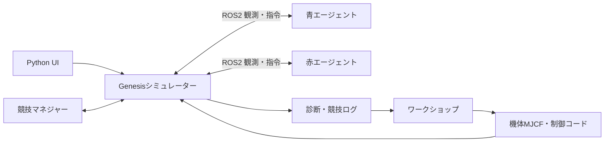

# 構成と制御の契約

ゲームマネジャーとエージェントは独立した責務を持ちます。シミュレーターは物理状態と実行を担当し、得点やコインの状態は競技管理が担当します。戦略は交換可能です。

## 生成制御

`def control(s)` が各駆動関節の目標値を辞書で返します。最大64個の単純な変数を使えます。値は呼び出しごとに評価され、永続状態はありません。利用可能な状態はt、dt、linear、angular、lift、frame_target、climb_stage、関節角q・関節速度qdです。

加減乗除、剰余、比較、条件式、sin/cos/sqrt/acos/asin/atan2/abs/min/max/clipが利用できます。最大24000文字・6000 ASTノード・式深さ32に制限し、import、ループ、補助関数、再帰、ファイルアクセスや任意Python実行は許可しません。

生成されたコードは実行中の状況に応じて目標値を変えますが、毎フレームLLMへ再生成を依頼する方式ではありません。機体・制御の生成／修正はワークショップで行います。

`lift=1` は登坂指令があることを示し、接触を測定した値ではありません。胴体姿勢や接地点を、この生成制御が既に受け取れるわけではありません。ROS2で扱うセンサーデータと生成コードの入力範囲を混同しないでください。

## 既知の課題

生成物の構文・形状が検証に通っても、歩行・旋回・段差通過が成功するとは限りません。接近時のアーム干渉、荷重と反力、可動域、後輪の通過など、機体設計側の検証も必要です。コードやゲインを繰り返し調整するだけでは解決できない場合があります。

改善プロンプトは `docs/prompts/` に版を分けて保持しています。アプリが固定プロンプトを自動改訂する仕組みではありません。
